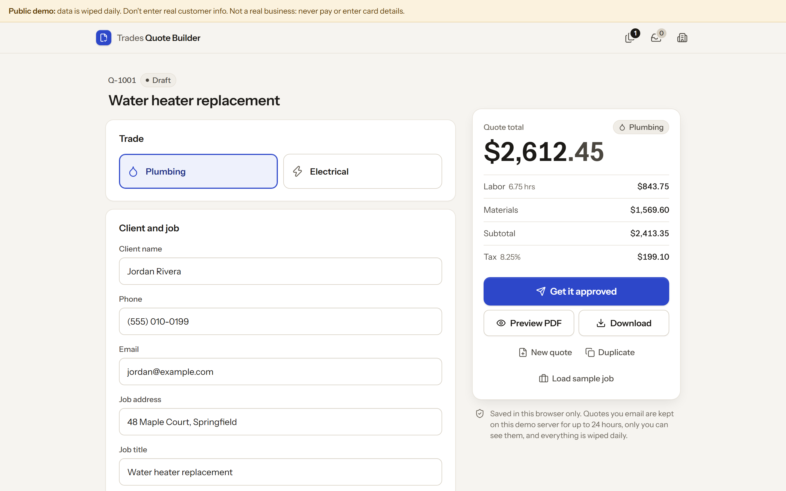
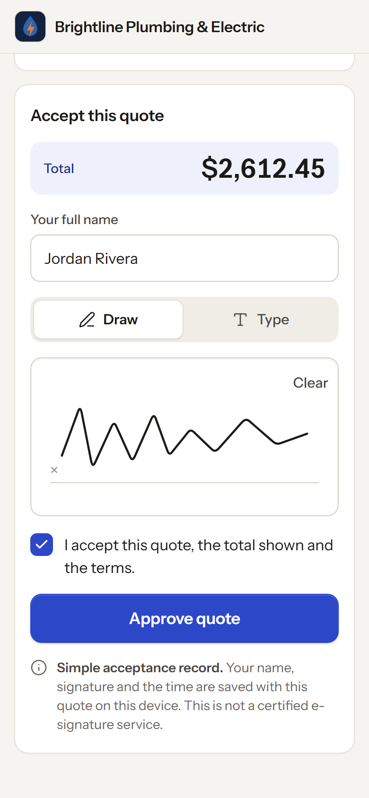

# Trades Quote Builder

Build a professional plumbing or electrical quote in under a minute, download a
branded PDF, and get it approved two ways: the customer signs on the spot, or
you email it with a private "Review & approve" link and automatic follow-ups.
No accounts. Quotes are saved in the browser; emailed quotes are also stored on
this app's own server so the customer can open the link.





Built by a [KrewBots](https://krewbots.com) agent. Free and open source under the [MIT licence](LICENSE).

## Run it

```sh
npm start            # http://localhost:4174   (PORT=5000 npm start to change)
npm run demo         # same, in demo mode: labelled mock Outbox + demo clock
```

No install step is needed to run the app (Node 20+ only). Click **Load sample
job** to fill in a fictional business and client for demos. Use
`npm run demo` to try the email flow without sending anything: emails land in
the **Outbox** (marked "Demo · mock, not really sent") and the **Demo clock**
(+1 / +2 days) moves the server's clock so follow-ups fire straight away.

**No real email is sent by default.** Out of the box (`npm start`) email is off
and the app says so. `npm run demo` uses the mock Outbox. Real sending needs
the environment variables below, including an allowlist of recipients.

## What it does

1. **Job to quote.** Pick Plumbing or Electrical, enter the client, then add
   line items from the built-in price book (46 common jobs, each with labor
   hours and materials cost). Edit any price in **Price book > Edit prices** or
   add custom items; edits are saved on this device. Set labor rate, materials
   markup, sales tax (on everything or materials only) and validity. Totals
   update live.
2. **Describe the job.** Type what the customer needs ("6 can lights and a
   GFCI in the bathroom") and matching price-book items are suggested by local
   keyword matching, including quantities. No AI API is called.
3. **Branded PDF.** Business name, uploaded logo, license number, client, line
   items, totals, terms and valid-until date, generated in the browser by a
   small dependency-free PDF writer (`public/lib/pdf-writer.js`, standard
   Helvetica, US Letter). **Preview PDF** shows the same layout on screen.
4. **Approve on site.** **Get it approved > Approve on site** opens
   `/approve/<id>` on the same device: the customer reviews the quote, draws or
   types a signature, ticks acceptance and approves. The quote flips to
   **Approved** with a timestamp, is locked, and a signed PDF can be downloaded.
   The quote is read from this browser's storage, so this page only opens on the
   device that created it.
5. **Email to customer.** **Get it approved > Email to customer** sends a
   branded email with the quote summary, the PDF attached and a **Review &
   approve** button. The link is `/review/<id>/<token>` on this server: a
   256-bit random token (only its SHA-256 hash is stored, compared in constant
   time) that stops working after the quote's valid-until date. The customer can
   approve (draw or type a signature) or decline. The builder polls the server
   and flips to **Approved** or **Declined** with the timestamp.
6. **Automatic follow-ups.** Reminders at 2 and 5 days by default, editable per
   quote, on/off per quote. They stop immediately when the customer approves or
   declines, and are never scheduled past the valid-until date. If several are
   overdue (server was off), only the latest is sent. The quote list shows
   "Follow-up sent <date> · next follow-up <date>".

Approvals in both modes are a *simple acceptance record*, **not** a certified
e-signature service.

## Email setup

With no provider configured, the email tab says **"Email isn't set up"** and
nothing is sent or faked. Configure the server with environment variables:

| Variable | |
|---|---|
| `TQB_EMAIL_PROVIDER` | `resend` or `smtp` |
| `TQB_EMAIL_FROM` | e.g. `Brightline Quotes <quotes@example.com>` |
| `RESEND_API_KEY` | for Resend |
| `SMTP_HOST`, `SMTP_PORT`, `SMTP_USER`, `SMTP_PASS`, `SMTP_SECURE` | for SMTP (`SMTP_SECURE=true` for port 465; otherwise STARTTLS is required) |
| `TQB_EMAIL_ALLOWLIST` | **required**: comma-separated addresses real emails may go to. Any other recipient is refused. |
| `TQB_PUBLIC_URL` | base URL used in review links (default: the address you opened the app on) |
| `TQB_DATA_DIR` | where emailed quotes are stored (default `data/`, git-ignored) |

The allowlist guard is deliberate for this build: real sends only reach
allowlisted test inboxes. Customers on other devices can only open review links
if this server is reachable from their device; public hosting is out of scope.

## Privacy and security

- Quotes, business details and the price book live in your browser's
  `localStorage` (`tqb.*`). They never leave the device unless you email a quote.
- Emailed quotes are stored on **your own** quote server (the machine running
  `server.mjs`, in `data/quotes.json`) and nowhere else, so customers can open
  them: the quote snapshot, the recipient, signature and
  follow-up log. Review tokens and the builder's owner key are stored only as
  hashes. The demo Outbox keeps a copy of each mock email (demo mode only).
- `server.mjs` serves `public/` with a strict CSP: `default-src 'self'`,
  `connect-src 'self'`, no inline scripts or styles, no form posts. The Outbox
  email preview is a separate sandboxed document with no scripts at all.
- State-changing API calls reject cross-site requests; owner endpoints need the
  per-quote owner key the builder received when it first emailed the quote.
- Fonts (Instrument Sans, Caveat; SIL OFL, licences in
  `public/fonts/`, see [THIRD_PARTY_NOTICES.md](THIRD_PARTY_NOTICES.md)) are
  bundled. Nothing loads from a CDN. No analytics or tracking.
- Don't put a normal instance on the public internet. For a public demo, use
  the public demo mode below.

## Public demo mode (`DEMO_MODE=1`)

For running an open demo on the internet (the `Dockerfile` and `railway.json`
set it up). On top of demo mode:

- **No real email, ever.** Every email setting (`TQB_EMAIL_*`, `RESEND_API_KEY`,
  `SMTP_*`) is ignored. Mail only goes to the mock Outbox, and each visitor's
  Outbox only shows the emails their own browser sent (a random session cookie).
- **Rate limits** per client IP: 240 requests/min, 20 writes/5 min, and 20
  wrong review links or owner keys per 10 min (then even right ones wait). There
  is also a global cap of 600 writes/hour. Over a limit, the API answers 429 (or 503 for the
  global cap) with "The demo is busy right now", plus `Retry-After`. The client IP
  comes from the header the platform's edge sets (`TQB_CLIENT_IP_HEADER`; on
  Railway `X-Real-IP` automatically, since Railway doesn't append to
  `X-Forwarded-For`). Otherwise it is the right-most `X-Forwarded-For` entry (one trusted
  proxy hop, `TQB_TRUST_PROXY_HOPS`), and entries to its left are ignored.
- **Caps**: 1 MB request body, 1 MB logo file, JPEG images at most 400 KB and
  2000 px a side, 50 line items. The store is in memory only: 300 quotes,
  300 mock emails, 50 MB total, oldest deleted first.
- **Data lifecycle**: everything is wiped on start and daily at 04:00 UTC. Review
  links stop working 24 hours after sending. The demo clock goes at most 30 days ahead.
- **Content**: a "Public demo: data is wiped daily" banner on every page;
  `robots.txt` disallows all crawling, and `X-Robots-Tag: noindex, nofollow` plus a
  noindex meta tag are on every page. User text is always escaped, and the only
  link in an email is the server's own review link (from `TQB_PUBLIC_URL` or
  `RAILWAY_PUBLIC_DOMAIN`, never the request's `Host` header).
- **Ops**: `/health`, HSTS behind HTTPS, `X-Frame-Options: DENY`,
  request/header timeouts, bounded connections, graceful shutdown on SIGTERM,
  and errors that never reveal details. Logs never contain user data.

```sh
DEMO_MODE=1 npm start
docker build -t trades-quote-builder . && docker run -p 8080:8080 trades-quote-builder   # runs as the non-root node user
```

## Tests

```sh
npm ci                              # dev dependency: Playwright
npx playwright install chromium     # once
npm test             # unit: pricing math, price book, PDF, tokens, follow-ups, mailer (mocked HTTP/SMTP), API, public demo lock
npm run test:e2e     # Chromium 390px/1440px: on-site + emailed approval, follow-ups, 1080x1920 frames, public demo
npm run test:all
SCREENSHOT_DIR=/some/folder npm run test:e2e   # where screenshots and PDFs are saved (default test-results/, git-ignored)
```

Screenshots and PDFs are written once, after the suite finishes. If one is open
in another program (for example an image viewer), it is listed in a warning
instead of failing the run; close it and run again to refresh that file.

The end-to-end suite runs the sample job through quote, PDF download (checks it
is a valid PDF with the expected totals), signing (drawn at 390px, typed at
1440px), Approved with timestamp and the signed PDF. It fails on any console
error or any request that leaves the page's own origin.

## Files

```
server.mjs              static server + CSP, /approve/<id> and /review/<id>/<token> routes
public/index.html       quote builder        public/app.js
public/approve.html     customer approval    public/approve.js
public/styles.css       job-site look (navy, hi-vis orange, condensed type)
public/lib/pricing.js   quote math (cents rounding)
public/lib/pricebook.js price book + keyword suggestions
public/lib/pdf-writer.js, quote-pdf.js   PDF generation
public/lib/paper.js     HTML preview of the PDF layout
public/lib/model.js, store.js, browser.js   data shapes, storage, signature pad
public/review.html      emailed review link  public/review.js
server/api.js           quote API: email, review, approve/decline, outbox, demo clock
server/store.js, tokens.js, followups.js, mailer.js, email-templates.js
server/public-demo.js   DEMO_MODE=1 lock: limits, rate limiting, visitor sessions, banner, daily wipe
Dockerfile, railway.json   public demo container (non-root, one replica, /health check)
```

## Licence

MIT, see [LICENSE](LICENSE). Bundled fonts are under the SIL Open Font License; see [THIRD_PARTY_NOTICES.md](THIRD_PARTY_NOTICES.md).
